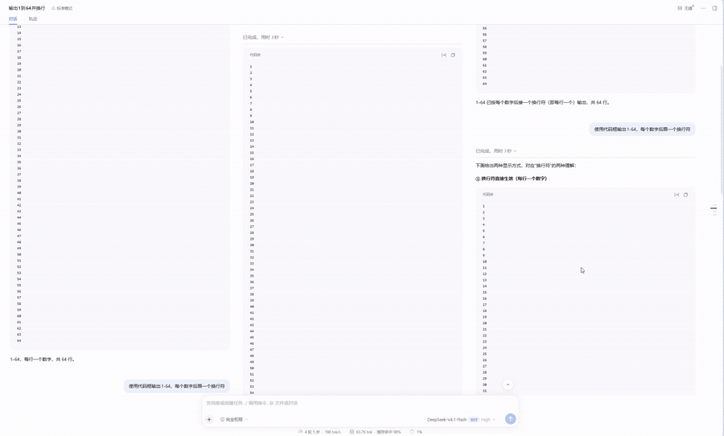
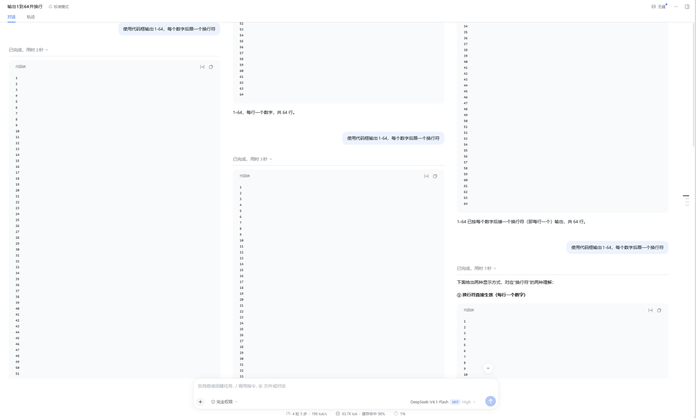

# dsh-chat-columns

**给 DSH Web 的会话阅读器。** 同一段对话，四种读法，默认「原生」——装上不改变任何东西。



---

## 四种读法

| 模式 | 一句话 | 什么时候用 |
|---|---|---|
| **原生** | 宿主原样，插件只是待命 | 默认。不想用插件时就是它 |
| **报纸** | 横向用满，CSS 均衡分栏，所有列共用宿主那一个滚动容器 | 快速扫一遍全貌 |
| **无缝** | 一屏一列，接缝相对内容连续推进；内容不切断、不会整块跳列 | 顺着读一段长讨论 |
| **复制** | 同一段对话复制成 N 栏，每栏独立滚动 | 前后对照、来回翻查 |

无缝有三种排法：**竖向**（默认）、**横向**、**翻页**。



> 上图那个会话里全是 64 行的代码块——故意挑的极端内容，用来看「代码块被列缝切开」长什么样。

---

## 安装

```bash
node scripts/install.mjs --profile web
```

脚本会自己建链接、写 `dsh.profile.bundles`，改之前先备份 `package.json`。

**装完必须重启 `dsh-web`**：`lib/client.js` 是启动时读进内存并按 rev 缓存的，只刷新页面还是旧字节。

不需要 `npm install`，也不需要 build——`lib/client.js` 已随仓库提交。

---

## 怎么用

右上角有一个半透明胶囊（和 文件夹 / ⋯ / 面板 并排），点开是面板：

| 控件 | 说明 |
|---|---|
| 显示模式 | 原生 / 报纸 / 无缝 / 复制 |
| 列数 | 自动 / 1 / 2 / 3（自动 = 每列 ≥420px，最多 3 列） |
| 到顶自动加载更早 | 每个模式独立记忆：报纸默认关，无缝和复制默认开 |
| 加载更早 | 手动触发宿主的「加载更早」 |

偏好存在 `localStorage['dshc-settings']`。第一次装完默认「原生」。

---

## 已知限制

这些都是**设计上的取舍**，不是待修的 bug：

1. **复制模式只能读**：按钮点不动、表单不能编辑。React 节点不能搬，克隆出来的交互是死的。
2. **「交互」档置灰**：跨缝那份要能交互，需要宿主放行 flow 的 `renderSlot`，留给 2.0。
3. **代码块会被列缝切开**：为了平分列高，含代码块的消息也会被截断；长行是软换行，否则 `pre` 不可分片。
4. **竖向的最小单元是消息**：一条消息不跨列，所以列底可能留白——这是「不被切断」的代价。
5. **超高消息**（> 一屏）在消息内部滚动，会多一层滚动条。
6. **跨缝选中会断**，`Ctrl+F` 会命中两份：同一份内容被渲染在多个窗口里。
7. **复制模式内存 = N 份 DOM**：几百条长对话会变慢，列数上限 3。

---

## 开发

```bash
npm run build     # src/ → lib/client.js
npm test          # math 单测
npm run check     # 静态检查（契约隔离 / CSS 作用域 / 产物新鲜度）
npm run smoke     # 最小 DOM 桩 + 契约夹具：apply → mount → 各模式 → unmount
npm run verify    # 以上全部
```

**改完 `src/` 必须 build 并重启 `dsh-web`**，只刷新页面不生效。

调试：浏览器控制台执行 `__dshc.diagnose()`。

---

## 交接

要接手这个项目的 agent 看 **[HANDOFF.md](HANDOFF.md)**：模块职责、宿主契约、不变量、已知缺陷的代码位置、踩过的坑。
